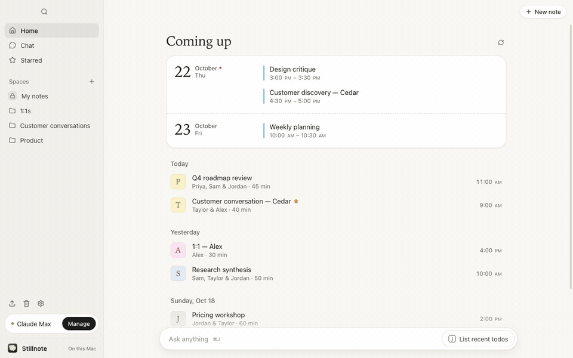

# Stillnote

A local macOS meeting notebook inspired by Granola, powered by your ChatGPT or Claude subscription instead of an API key.

Stillnote keeps the core loop small: **open a note → capture a conversation → jot down what matters → enhance the notes → ask follow-up questions**. Its home feed, focused document view, and bottom recording/chat dock follow Granola's interaction patterns. It is an independent project, not an official Granola client.



<sub>Real app, fictional meeting: the demo and screenshots below run on test fixtures, so no account, microphone or notebook of anyone's is involved. Regenerate them with `npm run screenshots -- --demo`.</sub>

## Core capabilities

- **Meeting capture:** microphone plus optional system audio, without a meeting bot.
- **On-device transcription:** on macOS 26 and later, Apple's SpeechTranscriber streams the whole meeting with punctuation and per-phrase timestamps, using the meeting title, participants and notes as vocabulary hints. Earlier macOS versions fall back to `SFSpeechRecognizer`. **Auto language** (macOS 26) listens in two languages at once, Chinese and English by default, and keeps whichever transcribed each sentence convincingly, so meetings that switch languages come out right. Microphone and meeting audio get separate labels. No transcription API key. Original microphone and system-audio tracks are retained locally for playback and transcription retry.
- **Replay and diagnose:** separate source players with seeking, live input meters, recognition language, sparse-transcript warnings, and retry from the saved audio. Earlier app versions did not retain audio, so historical audio cannot be recovered.
- **A simple notebook:** autosaved rough notes, editable transcripts, folders, stars, search, and recoverable Trash.
- **Enhanced notes:** modeled on Granola's. Your rough notes are the skeleton and stay in dark text; details, missed topics and next steps from the transcript are added in lighter text. Short topic headings, terse bullets, no filler, in the language you wrote in. Templates (1:1, customer discovery, standup, interview, or your own) set the sections. Previous summaries remain available. Optionally enhance automatically when recording ends.
- **Meeting chat:** ask about one meeting, a folder, or your notebook. Source citations open the corresponding transcript. Apply a chat answer to your enhanced notes explicitly.
- **Your calendar:** read meetings from accounts configured in Apple Calendar, including Google or Outlook accounts. Create a note from an event; each occurrence keeps one note.
- **Meeting reminders:** once the calendar is connected, Stillnote refreshes it in the background and notifies you a minute before each timed meeting. Clicking the notification opens that meeting's note, joins its Google Meet, Zoom or Teams call when the event has one, and starts recording (switchable in **Settings › Recording**). Reminders appear while Stillnote is running.
- **Start or join a call in one click:** **Start Google Meet** (or Zoom) on Home opens a new meeting in your browser or meeting app and records it in a new note; **Join & record** on a calendar meeting opens its call link and records in its note.
- **Meeting detection:** when another app starts using your microphone, like a Zoom or Meet call, Stillnote asks “Meeting detected — take notes?” once per call. It reads macOS's microphone state only and never records by itself; turn it off in **Settings › Recording**, where **Open Stillnote when a meeting is detected** (off by default) also brings the window forward.
- **English and 简体中文:** the interface follows the macOS language (any Chinese → 简体中文) and can be changed in **Settings › General**, including menus, notifications and macOS permission prompts. Notes, transcripts and enhanced notes keep the language of the meeting.
- **Local ownership:** SQLite storage, Markdown export, JSON backup/restore, and an optional read-only local MCP server.

## Screenshots

| | |
| --- | --- |
|  |  |
| **Home.** Upcoming meetings from your calendar, then recent notes by day. | **Recording.** Write rough notes while the on-device transcript fills in. |
|  |  |
| **Enhanced notes.** Your own points stay dark; what the transcript adds is lighter. | **Chat.** Ask a meeting, a folder or the notebook; answers link back to sources. |
|  |  |
| **Recordings.** Replay each source, or retry transcription from the saved audio. | **AI provider.** Use your Claude or ChatGPT plan; usage shows next to it. |
|  |  |
| **Recording settings.** Microphone, meeting language, meeting audio and reminders. | **Dark mode.** Follows macOS appearance. |
|  | |
| **简体中文.** The interface follows your Mac's language. | |

Team workspaces, cloud synchronization, public sharing links, mobile apps, CRM integrations, and automatic identification of every remote speaker are intentionally outside this version's scope.

## Run locally

Requires macOS 13 or later, Node.js 24 or later, and Xcode Command Line Tools (`xcode-select --install`). The build uses the local Mac's CPU architecture. The current implementation was built and checked on Apple Silicon; Intel and macOS 13 have not been separately exercised.

```sh
git clone https://github.com/Michael-Ma/stillnote.git
cd stillnote
npm ci
npm start
```

To create a standalone app:

```sh
npm run signing:setup   # once per Mac
npm run package
npm run install:app     # optional: replace /Applications/Stillnote.app
```

The app is written under `release.noindex/mac-arm64/Stillnote.app` on Apple Silicon, or `release.noindex/mac/Stillnote.app` on Intel. The `.noindex` suffix keeps Spotlight and Launchpad from listing this build next to the copy you install in `/Applications`. Use the packaged app for macOS permission testing; development runs may identify the host process as Electron.

Packaging signs with a valid **Apple Development** certificate when you have one (free: Xcode › Settings › Accounts, then Manage Certificates; if signing reports “unable to build chain”, install Apple’s Worldwide Developer Relations G3 intermediate from apple.com/certificateauthority). Its Team ID keeps both privacy permissions and the keychain’s “Always Allow” across rebuilds. Without one, `signing:setup` adds a self-signed “Stillnote Local Signing” certificate to your login keychain, which keeps privacy permissions but not the keychain’s per-build approval. Every build is signed with it, so macOS keeps trusting rebuilt copies: after you choose **Always Allow** for the “Stillnote Safe Storage” keychain item and grant recording permissions once, later builds do not ask again. Without it, builds are signed ad hoc and macOS treats every rebuild as a new app. Changing identity, for example from the local certificate to Apple Development, is also a new app to macOS: if a permission prompt keeps returning although Stillnote is switched on in System Settings, remove Stillnote from that list with − and allow it again. Either way this is a local development build, not an Apple-notarized distribution. Scripted test launches use Chromium's mock keychain and never touch the real keychain item. `install:app` quits a running Stillnote normally, stages the new copy beside the old one and swaps it in with a rename, so a launch during an update never sees a half-copied app.

## Connect your ChatGPT plan

1. Open **Settings** from the bottom-left corner.
2. Choose **Continue with ChatGPT**.
3. Finish sign-in in your system browser and allow ChatGPT plan usage.
4. Return to Stillnote and choose an available model.

This uses OpenAI's documented **Sign in with ChatGPT** flow for eligible local personal projects. It does not read an existing Codex login, copy browser cookies, or use private ChatGPT endpoints. Eligibility, available models, and account limits are determined by OpenAI. A connected badge does not prove model access; a completed request does.

The subscription route supports text inference but **does not include the transcription API**. That is why audio is transcribed on the Mac. See the official [sign-in guide](https://developers.openai.com/siwc/token-sharing-open-source/sign-in) and [preview limitations](https://developers.openai.com/siwc/token-sharing-open-source/preview-limitations).

## Or use your Claude plan

If Claude Code is installed and signed in with a Claude Pro or Max plan, Stillnote detects it and can use it with no extra setup.

1. Open **Settings** and choose **Claude**.
2. If Claude Code is missing, choose **Install Claude Code**. Terminal runs Anthropic's official installer (`curl -fsSL https://claude.ai/install.sh | bash`) and then `claude auth login`.
3. If it is installed but signed out, choose **Sign in to Claude**. Sign-in completes in your browser through Anthropic's own flow. You can also run `claude auth login` yourself.
4. Choose a model (Sonnet by default).

Stillnote runs your own, unmodified `claude` program in print mode with tools, MCP servers, hooks, and CLAUDE.md files disabled, from an empty working folder. It never reads Claude credentials or the keychain and stores no Claude tokens. `ANTHROPIC_API_KEY` is removed from the program's environment, and a Claude Code that is signed in with an API key rather than a plan is refused, so usage is never silently billed to an API account. Requests count against your Claude plan's usage limits. See Anthropic's [legal and compliance](https://code.claude.com/docs/en/legal-and-compliance) notes on subscription sign-in.

## Take your first note

1. Choose **New note**, or connect your Mac calendars and select a meeting under **Coming up**.
2. Press **Record** in the dock at the bottom.
3. Grant **Microphone**, **Speech Recognition**, and, for meeting audio, **Screen & System Audio Recording** access in macOS.
4. Write a few notes while the transcript accumulates.
5. Press the stop button in the dock. **Transcript** and **Recordings** in the dock show how many lines and saved recordings the note has; choose **Recordings** to listen to the saved sources or retry transcription. If ChatGPT or Claude is connected and automatic enhancement is enabled, Stillnote enhances notes unless transcript coverage looks sparse. You can also choose **Enhance notes** later. Rough notes are optional.

Choose the microphone and meeting language in **Settings › Recording**. **Auto** picks between two languages sentence by sentence; it runs two transcribers per source, and if this Mac cannot, it continues in the first language and says so. On macOS 26 and later, languages such as Chinese (Mandarin, Taiwan, Hong Kong), Cantonese, Japanese and Korean download inside Stillnote; on earlier versions, install the language for Dictation in macOS Settings. If a source stays silent during a recording, the dock says so and links to the microphone setting. Plugging or unplugging a headset mid-meeting restarts the input automatically. Audio capture continues even when recognition is unavailable, and Stillnote never switches to a cloud transcription service. If meeting audio is denied, the warning says what to change and opens the right Settings pane. Quitting or logging out mid-recording stops the recording and saves its audio before Stillnote closes.

**Shortcuts:** `⌘N` new note, `⌘K` search from Home, `⌘J` toggle chat, `⌘⇧T` toggle the note's transcript.

## Where data lives

| Run mode | Default data directory |
| --- | --- |
| From source | `.data/` in this checkout |
| Packaged app | `~/Library/Application Support/Stillnote/` |
| Override | Set `STILLNOTE_DATA_DIR` to an absolute directory |

Notes, transcripts, and chat history are stored locally in `notebook.sqlite`. This notebook database is not application-encrypted; macOS account access and FileVault are the disk protection boundary. ChatGPT credentials are separately encrypted with Electron's macOS `safeStorage` mechanism and are never included in notebook backups or renderer state. Stillnote holds no Claude credentials; Claude Code keeps its own sign-in.

**AI is online:** selected notes, transcripts, and recent chat context go to OpenAI or Anthropic, whichever you use, when you enhance or chat. Automatic enhancement is enabled by default once an AI plan is connected; it can be disabled in Settings. Audio is saved as separate 16 kHz mono PCM WAV files under `recordings/<meeting-id>/<session-id>/`, and is never sent to an AI provider. It remains until you remove the local files; moving a note to Trash does not remove audio. Storage is approximately 110 MiB per hour per source. JSON notebook backups explicitly exclude these audio files; copy the data folder separately to preserve audio.

## Development and verification

```sh
npm test                 # storage, search, imports, streaming, synthetic OAuth and Claude CLI tests
npm run test:claude      # opt-in: one tiny live request through your own Claude Code
npm run test:ui          # original notebook smoke checks
npm run test:e2e         # reusable notebook/capture/playback/AI/crash-recovery suites
npm run test:native-scheduler # deterministic native scheduling regression
npm run test:native      # real native audio writer with synthetic speech
npm run test:native -- --long # 60+ second native audio regression
npm run test:native:recognize # opt-in on-device recognition; macOS permission may be needed
npm run test:native -- --long --recognize --streamed --dual-source # both sources, synthetic audio
npm run format:check     # source formatting
npm run build            # Swift helper, Electron main/preload, and renderer
npm run package          # standalone macOS app
npm run screenshots      # README screenshots from fictional fixtures; add `-- --demo` for the GIF
npm run test:native:languages # opt-in: Auto language on synthetic Chinese/English speech (`-- --live` streams it)
```

The desktop test exercises real persistence, transcript editing, folder assignment, stars, search, Trash/restore, Markdown export, immediate-close draft saving, and sign-in error recovery. The deterministic E2E suite replaces device, ChatGPT and Claude transports, but exercises the real renderer, IPC, SQLite, media protocol, seeking, decoded playback, and restart recovery. Native file dialogs are stubbed for import/export. The separate native tests use synthesized speech and the real audio writer; recognition is opt-in. No automatic test records a real meeting or accesses a real ChatGPT or Claude account; Claude provider tests drive a fake `claude` program.

See [validation results and remaining checks](docs/VALIDATION.md) for the evidence boundary. Live account inference and actual microphone/system-audio transcription still require a user-authorized acceptance test.

## Documentation

- [How it was built, architecture, and core components](docs/ARCHITECTURE.md)
- [UI/UX decisions and reference mapping](docs/DESIGN.md)
- [Icon design, source assets, and generation prompt](docs/ICON.md)
- [Three additional icon options](docs/ICON-OPTIONS.md)
- [Reusable E2E testing design and commands](docs/TESTING.md)
- [Recording and transcription diagnostics](docs/CAPTURE-DIAGNOSTICS.md)
- [Follow-up code review and reproduced failure](docs/CODE-REVIEW.md)
- [Validation and limitations](docs/VALIDATION.md)
- [Optional local MCP integration](docs/MCP.md)
