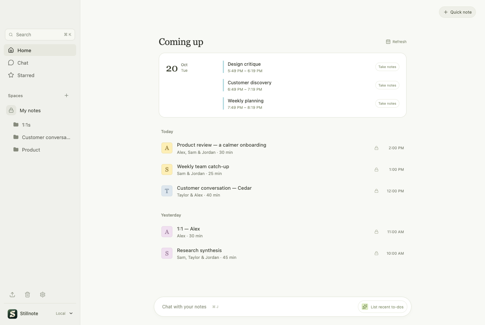
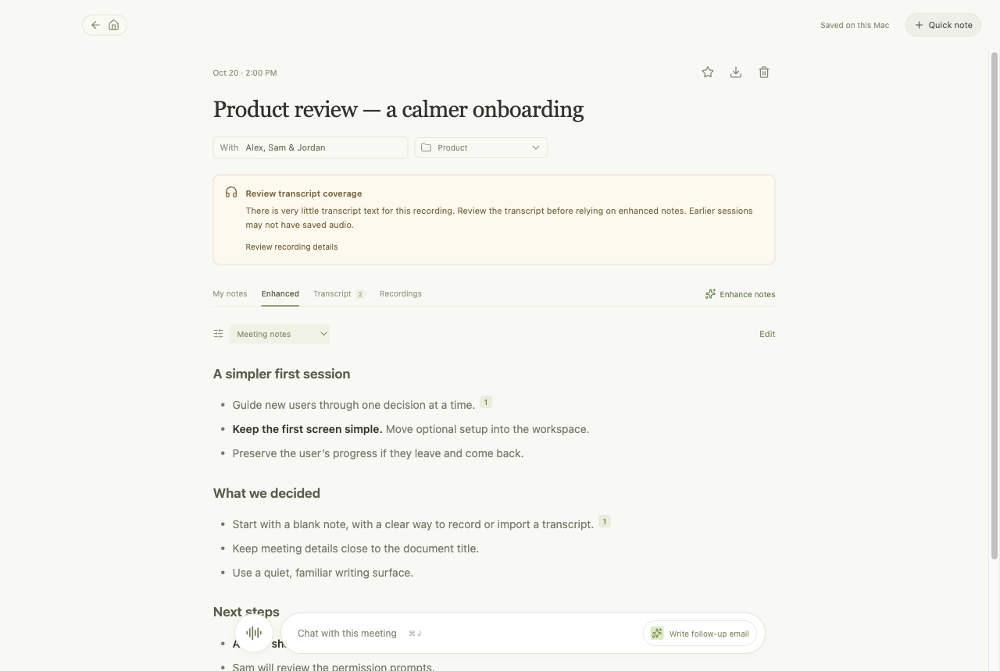

# Stillnote

A local macOS meeting notebook inspired by Granola, powered by your ChatGPT subscription instead of an API key.

Stillnote keeps the core loop small: **open a note → capture a conversation → jot down what matters → enhance the notes → ask follow-up questions**. Its home feed, focused document view, and bottom recording/chat dock follow Granola's interaction patterns. It is an independent project, not an official Granola client.



## Core capabilities

- **Meeting capture:** microphone plus optional system audio, without a meeting bot.
- **On-device transcription:** Apple's Speech framework, with separate microphone and meeting-audio labels. No transcription API key and no persisted audio recordings.
- **A simple notebook:** autosaved rough notes, editable transcripts, folders, stars, search, and recoverable Trash.
- **Enhanced notes:** combine your notes and transcript using a selected template. Previous summaries remain available. Optionally enhance automatically when recording ends.
- **Meeting chat:** ask about one meeting, a folder, or your notebook. Source citations open the corresponding transcript. Apply a chat answer to your enhanced notes explicitly.
- **Your calendar:** read meetings from accounts configured in Apple Calendar, including Google or Outlook accounts. Create a note from an event.
- **Local ownership:** SQLite storage, Markdown export, JSON backup/restore, and an optional read-only local MCP server.

Team workspaces, cloud synchronization, public sharing links, mobile apps, CRM integrations, and automatic identification of every remote speaker are intentionally outside this version's scope.

## Run locally

Requires macOS 13 or later, Node.js 24 or later, and Xcode Command Line Tools (`xcode-select --install`). The build uses the local Mac's CPU architecture. The current implementation was built and checked on Apple Silicon; Intel and macOS 13 have not been separately exercised.

```sh
git clone https://github.com/Michael-Ma/stillnote.git
cd stillnote
npm ci
npm start
```

To create a standalone app:

```sh
npm run package
```

The app is written under `release/mac-arm64/Stillnote.app` on Apple Silicon, or `release/mac/Stillnote.app` on Intel. This is an ad-hoc-signed local development build, not an Apple-notarized distribution. Use the packaged app for macOS permission testing; development runs may identify the host process as Electron.

## Connect your ChatGPT plan

1. Open **Settings** from the bottom-left corner.
2. Choose **Continue with ChatGPT**.
3. Finish sign-in in your system browser and allow ChatGPT plan usage.
4. Return to Stillnote and choose an available model.

This uses OpenAI's documented **Sign in with ChatGPT** flow for eligible local personal projects. It does not read an existing Codex login, copy browser cookies, or use private ChatGPT endpoints. Eligibility, available models, and account limits are determined by OpenAI. A connected badge does not prove model access; a completed request does.

The subscription route supports text inference but **does not include the transcription API**. That is why audio is transcribed on the Mac. See the official [sign-in guide](https://developers.openai.com/siwc/token-sharing-open-source/sign-in) and [preview limitations](https://developers.openai.com/siwc/token-sharing-open-source/preview-limitations).

## Take your first note

1. Choose **Quick note**, or connect your Mac calendars and select a meeting.
2. Press the waveform button at the bottom to start recording.
3. Grant **Microphone**, **Speech Recognition**, and, for meeting audio, **Screen & System Audio Recording** access in macOS.
4. Write a few notes while the transcript accumulates.
5. Choose **Finish meeting**. If ChatGPT is connected and automatic enhancement is enabled, Stillnote generates enhanced notes. Otherwise, choose **Enhance notes** later.

If on-device recognition is unavailable, enable Dictation and install the meeting language in macOS Settings, then restart Stillnote. It will not silently switch to a cloud transcription service. English, Chinese, and other language choices depend on the recognizer installed on your Mac.

**Shortcuts:** `⌘N` new note, `⌘K` search from Home, `⌘J` toggle chat.

## Where data lives

| Run mode | Default data directory |
| --- | --- |
| From source | `.data/` in this checkout |
| Packaged app | `~/Library/Application Support/Stillnote/` |
| Override | Set `STILLNOTE_DATA_DIR` to an absolute directory |

Notes, transcripts, and chat history are stored locally in `notebook.sqlite`. This notebook database is not application-encrypted; macOS account access and FileVault are the disk protection boundary. ChatGPT credentials are separately encrypted with Electron's macOS `safeStorage` mechanism and are never included in notebook backups or renderer state.

**AI is online:** selected notes, transcripts, and recent chat context go to OpenAI when you enhance or chat. Automatic enhancement is enabled by default after you connect ChatGPT; it can be disabled in Settings. Audio remains in memory on the Mac and is not saved by the app.

## Development and verification

```sh
npm test                 # storage, search, imports, streaming, and synthetic OAuth tests
npm run test:ui          # real Electron workflows with isolated fictional test data
npm run format:check     # source formatting
npm run build            # Swift helper, Electron main/preload, and renderer
npm run package          # standalone macOS app
```

The desktop test exercises real persistence, transcript editing, folder assignment, stars, search, Trash/restore, Markdown export, immediate-close draft saving, and sign-in error recovery. Native file dialogs are stubbed only in the export test. No test records a real meeting or accesses a real ChatGPT account.

See [validation results and remaining checks](docs/VALIDATION.md) for the evidence boundary. Live account inference and actual microphone/system-audio transcription still require a user-authorized acceptance test.

## Documentation

- [How it was built, architecture, and core components](docs/ARCHITECTURE.md)
- [UI/UX decisions and reference mapping](docs/DESIGN.md)
- [Icon design, source assets, and generation prompt](docs/ICON.md)
- [Validation and limitations](docs/VALIDATION.md)
- [Optional local MCP integration](docs/MCP.md)


