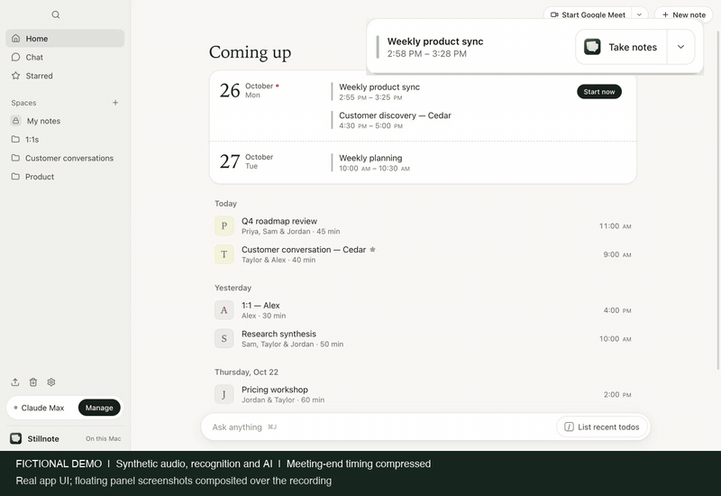
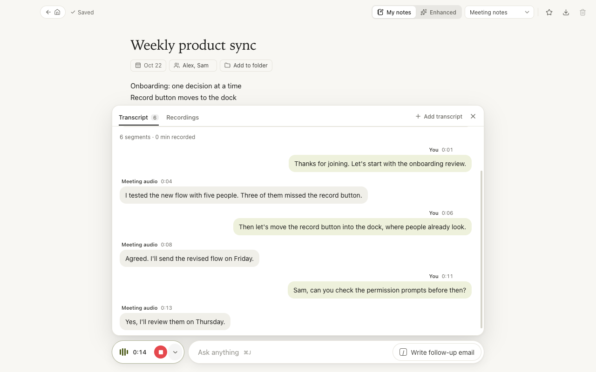
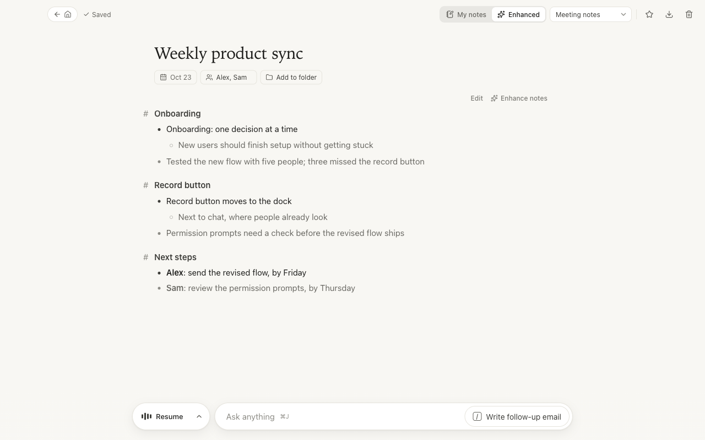
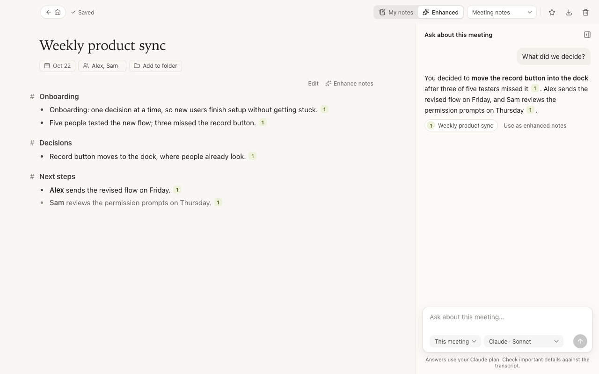
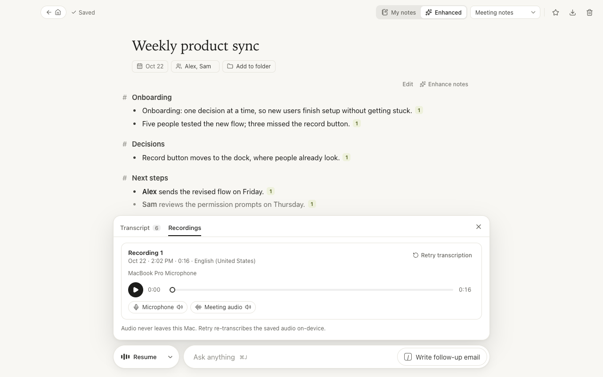
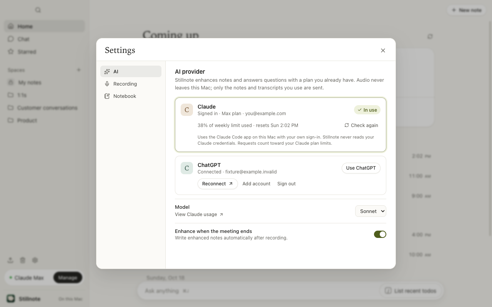
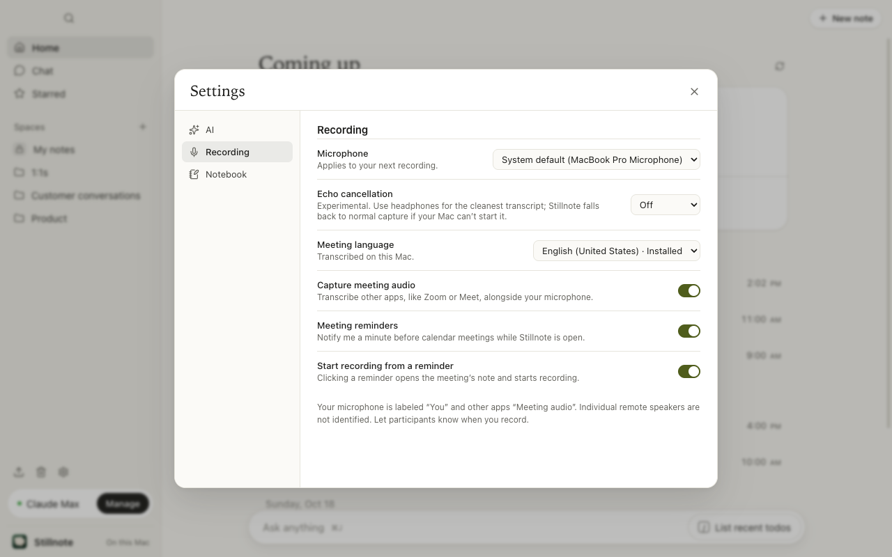
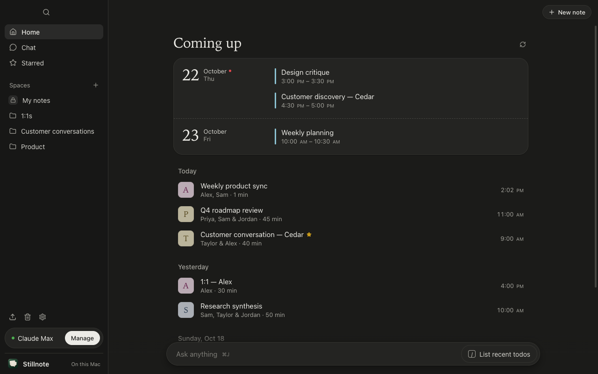
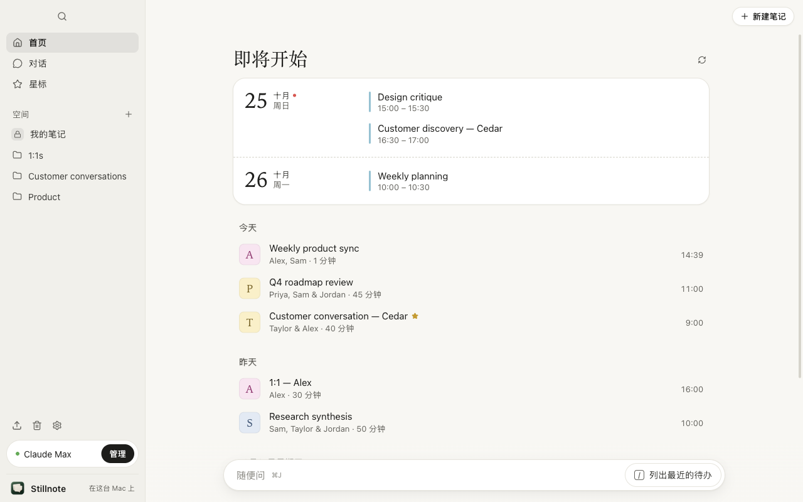

# Stillnote

A local macOS meeting notebook inspired by Granola, powered by your ChatGPT or Claude subscription instead of an API key.

Stillnote keeps the core loop small: **open a note → capture a conversation → jot down what matters → enhance the notes → ask follow-up questions**. Its home feed, focused document view, and bottom recording/chat dock follow Granola's interaction patterns. It is an independent project, not an official Granola client.

[](docs/images/demo.mp4)

[Watch the demo video (MP4)](docs/images/demo.mp4) · [View the poster](docs/images/demo-poster.png)

<sub>Real app UI with fictional meetings and synthetic audio, recognition and AI. The meeting-end timing is compressed; real floating-panel screenshots are composited over the recording. This demonstrates the workflow, not recognition accuracy or real account access. Regenerate with `npm run demo`; regenerate the still screenshots with `npm run screenshots`.</sub>

## Use on your Mac

**1. Install the prerequisites once.** macOS 26 or later is recommended. Install [Node.js 24 or later](https://nodejs.org/en/download), then open **Terminal** and run:

```sh
xcode-select --install
```

Finish Apple's tools installer before continuing. Already have the tools? Make sure they're up to date; the setup script will tell you if anything is missing.

**2. Install Stillnote.** Paste these commands into Terminal:

```sh
git clone https://github.com/Michael-Ma/stillnote.git
cd stillnote
bash scripts/setup-mac.sh
```

The script installs dependencies, builds and checks the app, then puts **Stillnote** in **Applications**. Your existing notes stay in place. You don't need an Apple developer account.

**3. Open Stillnote from Applications.** In **Settings**, connect ChatGPT or Claude for AI features. Choose **New note → Record**, allow microphone and system-audio access when asked, then stop recording and choose **Enhance notes**. You can record and take notes without connecting AI; no API key is needed.

**To update later:** in the same `stillnote` folder, run:

```sh
git pull --ff-only
bash scripts/setup-mac.sh
```

**Want to test setup without replacing your app or touching your notes?** Run:

```sh
bash scripts/setup-mac.sh --test
```

This builds the app, installs and upgrades a temporary copy, and checks that sample notes, transcripts and recordings survive. It uses a disposable notebook and leaves your installed app and real data alone. A normal installation replaces only the app; your notebook lives separately in `~/Library/Application Support/Stillnote/`.

For an extra backup before a normal update, quit Stillnote and copy that entire data folder somewhere safe. Copy the whole folder to include recordings; a JSON export does not include audio.

## Core capabilities

- **Meeting capture:** microphone plus optional system audio, without a meeting bot.
- **On-device transcription:** on macOS 26 and later, Apple's SpeechTranscriber streams the whole meeting with punctuation and per-phrase timestamps, using the meeting title, participants and notes as vocabulary hints. Earlier macOS versions fall back to `SFSpeechRecognizer`. **Auto language** (macOS 26) listens in two languages at once, Chinese and English by default, and chooses between the candidate transcripts sentence by sentence. The choice is heuristic; review uncertain passages against the recording. Microphone and meeting audio get separate labels. No transcription API key. Saved microphone and system-audio tracks stay on this Mac for playback and transcription retry; the meeting-end setting controls trailing-silence trimming.
- **Replay and diagnose:** synchronized playback with seeking and per-source mute, live input meters, recognition language, sparse-transcript warnings, and retry from the saved audio. Earlier app versions did not retain audio, so historical audio cannot be recovered.
- **A simple notebook:** autosaved rough notes, editable transcripts, folders, stars, search, and recoverable Trash; **Delete forever** and **Empty Trash** remove notes for good, and their audio goes to the macOS Trash.
- **Images in notes:** paste or drop a screenshot or photo into **My notes** and it shows in place between your lines (PNG, JPEG, GIF or WebP, up to 20 MB). Click it to see it large; Backspace at the start of the line below removes it, and Undo brings it back. The note text stays plain Markdown.
- **Enhanced notes:** modeled on Granola's. Your rough notes are the skeleton and stay in dark text; details, missed topics and next steps from the transcript are added in lighter text. Short topic headings, terse bullets, no filler, in the language you wrote in. Templates (1:1, customer discovery, standup, interview, or your own) set the sections. Previous summaries remain available. Optionally enhance automatically when recording ends.
- **Meeting chat:** ask about one meeting, a folder, or your notebook. Source citations open the corresponding transcript. Apply a chat answer to your enhanced notes explicitly.
- **Your calendar:** read meetings from accounts configured in Apple Calendar, or directly from a Google, Outlook or iCloud calendar's private link, without Apple Calendar. Create a note from an event; each occurrence keeps one note.
- **Bring your notes with you:** import captions and transcripts (Zoom, Teams, Meet, Otter, Fireflies), Markdown notes and Notion exports, or connect Granola or Notion and import straight from them. Importing the same thing again adds nothing.
- **Meeting reminders:** a floating panel at the top right shows the calendar's color and meeting time about a minute before it starts. **Join and take notes** opens the note, starts capture when enabled, then opens its Google Meet, Zoom or Teams link. The menu can take notes without joining, or start a new Meet/Zoom call for an event without a link. Stillnote must be running; these panels replace system notifications.
- **Start or join a call in one click:** **Start Google Meet** (or Zoom) on Home opens a new meeting in your browser or meeting app and records it in a new note; **Join & record** on a calendar meeting opens its call link and records in its note.
- **Meeting detection:** when another app starts using your microphone, like a Zoom or Meet call, Stillnote asks “Meeting detected — take notes?” once per call. Dictation (macOS's own, or apps such as Wispr Flow and Typeless) and other note-takers do not count as calls. It reads macOS's microphone state only and never records by itself; turn it off in **Settings › Recording**, where **Open Stillnote when a meeting is detected** (off by default) also brings the window forward.
- **Meeting end:** a quiet meeting that appears finished produces a prompt and, by default, a 60-second countdown before stopping. **Keep recording**, **Stop now**, and **Resume recording** let you control the session. **Settings › Recording › When a meeting seems over** selects automatic stopping, asking only, or Off. See [the exact conditions and audio-trimming behavior](#meetings-reminders-and-stopping).
- **English and 简体中文:** the interface follows the macOS language (any Chinese → 简体中文) and can be changed in **Settings › General**, including menus, the reminder panel and macOS permission prompts. Notes, transcripts and enhanced notes keep the language of the meeting.
- **Local ownership:** SQLite storage, Markdown export, JSON backup/restore, and an optional read-only local MCP server.

## Screenshots

| | |
| --- | --- |
|  |  |
| **Home.** Upcoming meetings from your calendar, then recent notes by day. | **Recording.** Write rough notes while the on-device transcript fills in. |
|  |  |
| **Enhanced notes.** Your own points stay dark; what the transcript adds is lighter. | **Chat.** Ask a meeting, a folder or the notebook; answers link back to sources. |
|  |  |
| **Recordings.** Replay each source, or retry transcription from the saved audio. | **AI provider.** Use your Claude or ChatGPT plan; usage shows next to it. |
|  |  |
| **Recording settings.** Microphone, meeting language, meeting audio and reminders. | **Dark mode.** Follows macOS appearance. |
|  | |
| **简体中文.** The interface follows your Mac's language. | |

Team workspaces, cloud synchronization, public sharing links, mobile apps, CRM integrations, and automatic identification of every remote speaker are intentionally outside this version's scope.

## Development setup

For a normal installation, use [Use on your Mac](#use-on-your-mac) above. These are the manual development and signing options.

Requires Node.js 24 or later and a Swift/Xcode toolchain with the macOS 26 SDK or newer (`xcode-select --install` installs the Command Line Tools available for your Mac). The app targets macOS 13 or later; modern SpeechTranscriber and in-app language downloads require macOS 26 or later. The build uses the local Mac's CPU architecture. The current implementation was built and checked on Apple Silicon; Intel and macOS 13 have not been separately exercised.

```sh
git clone https://github.com/Michael-Ma/stillnote.git
cd stillnote
npm ci
npm start
```

To create a standalone app:

```sh
npm run signing:setup   # once per Mac
npm run package
npm run install:app     # optional: replace /Applications/Stillnote.app
```

The app is written under `release.noindex/mac-arm64/Stillnote.app` on Apple Silicon, or `release.noindex/mac/Stillnote.app` on Intel. The `.noindex` suffix keeps Spotlight and Launchpad from listing this build next to the copy you install in `/Applications`. Use the packaged app for macOS permission testing; development runs may identify the host process as Electron.

Packaging signs with a valid **Apple Development** certificate when you have one (free: Xcode › Settings › Accounts, then Manage Certificates; if signing reports “unable to build chain”, install Apple’s Worldwide Developer Relations G3 intermediate from apple.com/certificateauthority). Its Team ID provides the stable identity used for privacy permissions and keychain approval across rebuilds. Without one, `signing:setup` adds a self-signed “Stillnote Local Signing” certificate to your login keychain. That can stabilize privacy permissions, but keychain approval can still recur. Without either identity, builds are signed ad hoc and macOS treats every rebuild as a new app. Changing identity, for example from the local certificate to Apple Development, is also a new app to macOS: if a permission prompt keeps returning although Stillnote is switched on in System Settings, remove Stillnote from that list with − and allow it again. Either way this is a local development build, not an Apple-notarized distribution. Scripted test launches use Chromium's mock keychain and never touch the real keychain item. `install:app` quits a running Stillnote normally, stages the new copy beside the old one and swaps it in with a rename, so a launch during an update never sees a half-copied app.

## Connect your ChatGPT plan

1. Open **Settings** from the bottom-left corner.
2. Choose **Continue with ChatGPT**.
3. Finish sign-in in your system browser and allow ChatGPT plan usage.
4. Return to Stillnote and choose an available model.

This uses OpenAI's documented **Sign in with ChatGPT** flow for eligible local personal projects. It does not read an existing Codex login, copy browser cookies, or use private ChatGPT endpoints. Eligibility, available models, and account limits are determined by OpenAI. A connected badge does not prove model access; a completed request does.

The subscription route supports text inference but **does not include the transcription API**. That is why audio is transcribed on the Mac. See the official [sign-in guide](https://developers.openai.com/siwc/token-sharing-open-source/sign-in) and [preview limitations](https://developers.openai.com/siwc/token-sharing-open-source/preview-limitations).

## Or use your Claude plan

If Claude Code is installed and signed in with a Claude Pro or Max plan, Stillnote detects it and can use it with no extra setup.

1. Open **Settings** and choose **Claude**.
2. If Claude Code is missing, choose **Install Claude Code**. Terminal runs Anthropic's official installer (`curl -fsSL https://claude.ai/install.sh | bash`) and then `claude auth login`.
3. If it is installed but signed out, choose **Sign in to Claude**. Sign-in completes in your browser through Anthropic's own flow. You can also run `claude auth login` yourself.
4. Choose a model (Sonnet by default).

Stillnote runs your own, unmodified `claude` program in print mode with built-in tools disabled and safe mode disabling user customizations, from a private working folder. Stillnote never reads Claude credential files or the keychain and stores no Claude tokens. Before each request it checks fresh CLI authentication under the same environment used for inference and verifies routing settings. Only direct Claude Pro/Max connections are supported. Unreadable status/settings, API sign-ins, custom endpoints, other providers, and managed configurations are rejected before sending meeting text; organizational policy is never disabled or rewritten. Inherited `ANTHROPIC_API_KEY` and `ANTHROPIC_AUTH_TOKEN` are removed, and settings that would restore them are rejected. Claude still controls account eligibility, plan limits, and any extra usage enabled on that account. See Anthropic's [CLI reference](https://code.claude.com/docs/en/cli-reference) and [legal and compliance](https://code.claude.com/docs/en/legal-and-compliance) notes.

## Take your first note

1. Choose **New note**, or connect your Mac calendars and select a meeting under **Coming up**.
2. Press **Record** in the dock at the bottom.
3. Grant **Microphone** and, for meeting audio, **Screen & System Audio Recording** access in macOS. The legacy speech engine also requests **Speech Recognition** permission; modern SpeechTranscriber uses installed on-device language models.
4. Write a few notes while the transcript accumulates.
5. Press the stop button in the dock. **Transcript** and **Recordings** in the dock show how many lines and saved recordings the note has; choose **Recordings** to listen to the saved sources or retry transcription. If ChatGPT or Claude is connected and automatic enhancement is enabled, Stillnote enhances notes unless transcript coverage looks sparse. You can also choose **Enhance notes** later. Rough notes are optional.

Choose the microphone and meeting language in **Settings › Recording**. The meeting language starts as **Auto (Chinese + English)**, which picks between two languages sentence by sentence; it runs two transcribers per source, and if one candidate cannot run, it continues with the working language and says so. On macOS 26 and later, languages such as Chinese (Mandarin, Taiwan, Hong Kong), Cantonese, Japanese and Korean download inside Stillnote; on earlier versions, install the language for Dictation in macOS Settings. If a source stays silent during a recording, the dock says so and links to the microphone setting. Plugging or unplugging a headset mid-meeting restarts the input automatically. Audio capture continues even when recognition is unavailable, and Stillnote never switches to a cloud transcription service. If meeting audio is denied, the warning says what to change and opens the right Settings pane. Quitting or logging out mid-recording stops the recording and saves its audio before Stillnote closes.

**Shortcuts:** `⌘N` new note, `⌘K` search from Home, `⌘J` toggle chat, `⌘⇧T` toggle the note's transcript.

## Meetings, reminders and stopping

A reminder's **Join and take notes** action waits for raw audio capture before opening the call. During another recording, it first stops and saves that note, then starts the next one. Clicking the panel's meeting title only opens the note. The panel's dismissal timer pauses while hovered; no macOS notification permission is required. The separate Home **Start** and **Join & record** buttons open the call and begin recording from the renderer, so they do not provide the reminder's capture-before-join ordering.

Meeting-end detection uses call apps' microphone activity (apps that only record, such as macOS's meeting-audio capture or Granola, do not count), transcript activity, sustained sound, and the linked calendar event. These are heuristics: an unrelated app, an inaccurate transcript, or a long pause can affect the result.

| Signal | When the meeting-end prompt can appear |
| --- | --- |
| A call app releases the microphone | It held the microphone for at least one minute during this recording, then both the release and last detected speech are at least 10 seconds old. |
| Calendar end | The event has ended and there has been no detected speech for two minutes. |
| Prolonged quiet | No detected speech for ten minutes, or twenty minutes while a call app still holds the microphone. This signal requires earlier speech or sustained sound. |

The default adds a **60-second countdown** after the prompt. Renewed speech can withdraw it; **Keep recording** resets the answered signals. **Only ask** leaves the decision to you. **Off** disables both end prompts and tail trimming. The floating panel also shows the prompt when Stillnote is in the background.

After a successful automatic or manual stop, Auto and Only ask modes may shorten the saved WAVs: they keep ten seconds after the last recognized speech or sustained sound, and trim only if at least another minute can be removed. The notice reports the amount. This changes the saved audio; Retry cannot recover a successfully removed tail. Very short untranscribed sounds can fall below the sustained-sound threshold, so choose **Off** when you need every captured sample. Track replacements are staged together; a failed or interrupted replacement restores the originals on rollback or startup recovery.

## Where data lives

| Run mode | Default data directory |
| --- | --- |
| From source | `.data/` in this checkout |
| Packaged app | `~/Library/Application Support/Stillnote/` |
| Override | Set `STILLNOTE_DATA_DIR` to an absolute directory |

Notes, transcripts, and chat history are stored locally in `notebook.sqlite`. This notebook database is not application-encrypted; macOS account access and FileVault are the disk protection boundary. ChatGPT credentials are separately encrypted with Electron's macOS `safeStorage` mechanism and are never included in notebook backups or renderer state. Stillnote holds no Claude credentials; Claude Code keeps its own sign-in.

**AI is online:** selected notes, transcripts, and recent chat context are sent to the chosen provider when you enhance or chat. ChatGPT requests use OpenAI; the supported Claude configuration uses Anthropic directly, as described above. Automatic enhancement is enabled by default once an AI plan is connected; it can be disabled in Settings. Audio is saved as separate 16 kHz mono PCM WAV files under `recordings/<meeting-id>/<session-id>/`, and is never sent to an AI provider. With meeting-end handling enabled, the saved files can first have long trailing silence removed as described above. Images in notes are saved under `recordings/<meeting-id>/images/`; the AI sees “[image]” in their place and never the image. The remaining audio and images stay until you delete the note forever (its folder then moves to the macOS Trash) or remove the local files; moving a note to Trash does not remove audio. Delete forever removes the note and its meeting-scoped chat; quoted content can remain in notebook/folder chat and subsequent backups. Storage is approximately 110 MiB per hour per source. JSON notebook backups explicitly exclude these audio files (they do include the images notes show, and Markdown exports embed them); copy the data folder separately to preserve audio.

## Development and verification

```sh
npm test                 # storage, search, imports, streaming, synthetic OAuth and Claude CLI tests
npm run test:claude      # opt-in: one tiny live request through your own Claude Code
npm run test:ui          # original notebook smoke checks
npm run test:e2e         # eight suites, including floating panels and meeting-end behavior
npm run test:native-scheduler # deterministic native scheduling regression
npm run test:native-lifecycle # delayed model startup, Stop, and per-source language fallback
npm run test:native      # real native audio writer with synthetic speech
npm run test:native -- --long # 60+ second native audio regression
npm run test:native:recognize # opt-in on-device recognition; macOS permission may be needed
npm run test:native -- --long --recognize --streamed --dual-source # both sources, synthetic audio
npm run format:check     # source formatting
npm run build            # Swift helper, Electron main/preload, and renderer
npm run setup:mac        # build, test and install in Applications
npm run package          # standalone macOS app
npm run screenshots      # README still screenshots from fictional fixtures
npm run demo             # build + capture + MP4/GIF/poster; requires ffmpeg and ffprobe
npm run test:native:languages # opt-in: Auto language on synthetic Chinese/English speech (`-- --live` streams it)
```

The desktop test exercises real persistence, transcript editing, folder assignment, stars, search, Trash/restore, Markdown export, immediate-close draft saving, and sign-in error recovery. The deterministic E2E suite replaces device, ChatGPT and Claude transports, but exercises the real renderer, IPC, SQLite, media protocol, seeking, decoded playback, and restart recovery. Native file dialogs are stubbed for import/export. The separate native tests use synthesized speech and the real audio writer; recognition is opt-in. No automatic test records a real meeting or accesses a real ChatGPT or Claude account; Claude provider tests drive a fake `claude` program.

See [validation results and remaining checks](docs/VALIDATION.md) for the evidence boundary. Live account inference and actual microphone/system-audio transcription still require a user-authorized acceptance test.

## Documentation

- [How it was built, architecture, and core components](docs/ARCHITECTURE.md)
- [UI/UX decisions and reference mapping](docs/DESIGN.md)
- [Icon design, source assets, and generation prompt](docs/ICON.md)
- [Three additional icon options](docs/ICON-OPTIONS.md)
- [Reusable E2E testing design and commands](docs/TESTING.md)
- [Recording and transcription diagnostics](docs/CAPTURE-DIAGNOSTICS.md)
- [Follow-up code review and reproduced failure](docs/CODE-REVIEW.md)
- [Validation and limitations](docs/VALIDATION.md)
- [Optional local MCP integration](docs/MCP.md)
