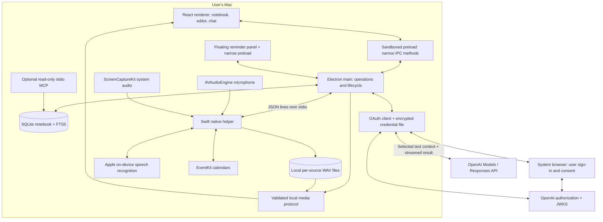
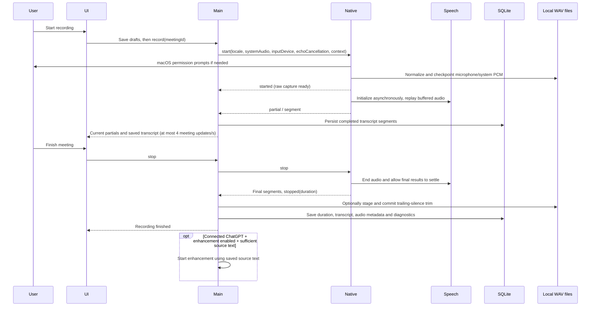

# Building Stillnote

Stillnote is a desktop meeting notebook with local capture and storage, plus text inference through an eligible ChatGPT plan or a supported direct Claude Pro/Max connection. The implementation deliberately separates the document, the recording session, and the AI response so that a failure in one does not erase the others.

## 1. Start with the constraints

The requested product is a Granola-like local application with the core meeting workflow, rather than Granola's complete cloud and team platform.

Two constraints determine the architecture:

1. **ChatGPT subscription access is an OAuth integration, not an API-key substitution.** OpenAI documents a public-client authorization flow, model discovery, streaming Responses requests, and limits. The app implements that protocol independently and uses the public `api.openai.com/v1` endpoint.
2. **That subscription route does not support transcription.** The Mac must turn audio into text before sending text to ChatGPT. Apple Speech can require on-device recognition, and ScreenCaptureKit can capture meeting-app audio without joining the meeting as a bot.

The architecture therefore uses Electron/React for the application, a small Swift process for macOS frameworks, SQLite for durable local data, and a main-process OAuth client for AI.

Official integration references, checked October 20, 2026:

- [Registration and sign-in](https://developers.openai.com/siwc/token-sharing-open-source/sign-in)
- [Models and inference](https://developers.openai.com/siwc/token-sharing-open-source/models-and-inference)
- [Accounts and sessions](https://developers.openai.com/siwc/token-sharing-open-source/profiles-and-sessions)
- [Preview limitations](https://developers.openai.com/siwc/token-sharing-open-source/preview-limitations)

No OpenAI DevKit source is vendored. OpenAI determines eligibility and service behavior; the app does not bypass those checks.

## 2. System architecture

The renderer does not have Node.js access, raw filesystem access, credentials, or a generic command-execution bridge. It loads bundled assets with a restrictive Content Security Policy. The main process validates the calling renderer and dispatches only named operations. The native helper accepts a small command vocabulary and never invokes the LLM.

## 3. Core components

| Component | Source | Responsibility |
| --- | --- | --- |
| Desktop coordinator | `app/main.mjs` | Creates the window, validates IPC senders, coordinates capture/AI, routes events, handles import/export dialogs, and flushes drafts before close with a five-second fallback. |
| Preload bridge | `app/preload.cjs` | Exposes the fixed `stillnote.call()` allowlist and event subscription; never exposes Electron or tokens directly. |
| Application UI | `app/ui.jsx` | Screen state, draft autosave, editor tabs, capture controls, chat scope/history, settings, and reversible actions. |
| Home feed | `app/components/HomeFeed.jsx` | Upcoming events, chronological meeting rows, search results, and honest empty states. |
| Content components | `app/components/Content.jsx` | Accessible icon buttons and safe Markdown with clickable meeting citations; only a note's own images render. |
| Notes editor | `app/components/NoteEditor.jsx` | CodeMirror over the note's plain Markdown: image lines drawn as atomic image widgets, pasted or dropped images saved and inserted on their own line, Backspace below an image deletes it. |
| Enhance prompt | `app/enhance.mjs` | Granola-style writing rules and the enhance request: template, meeting facts, rough notes and a timed transcript in fenced blocks. Pure. |
| Local store | `app/store.mjs` | SQLite transactions, FTS indexing, meeting revisions, folders, message history, backup validation/restore, and bounded AI context construction. |
| Subscription authentication | `app/auth.mjs` | PKCE/OIDC sign-in, profile separation, model discovery, protected token storage, refresh, revocation, and public Responses requests. |
| Streaming parser | `app/stream.mjs` | Decodes fragmented SSE events and accepts a result only after `response.completed`. |
| Native capture | `native/Capture.swift` | Microphone/system audio, normalized PCM WAV persistence, on-device recognition, device/language discovery, saved-file transcription, diagnostics, and EventKit reads. |
| Recording media | `app/recordings.mjs` | Validates recording paths, inspects/repairs canonical WAV headers, streams byte ranges, assesses sparse transcript coverage, builds vocabulary hints, and bounds native requests and recording UI updates. |
| Recording UI | `app/components/RecordingAudio.jsx` | Per-source playback, retry, language/source state, and coverage notices. |
| E2E harness | `scripts/e2e.mjs`, `tests/e2e/` | Isolated real Electron flows with deterministic native/provider adapters and persistent reports. |
| Local MCP | `scripts/mcp.mjs` | Optional read-only notebook access for local MCP clients. No network listener or write tools. |
| Build pipeline | `scripts/build.mjs` | Compiles the Swift executable, bundles main/preload with esbuild, and bundles React with Vite. |
| Packaging | `package.json` | Builds the macOS `.app`, bundles the native executable, and declares macOS permission descriptions. |

## 4. The capture path

### Native details

- `AVAudioEngine` captures the microphone. Capture, audio-track, and recognition-window state are isolated to the Swift main actor; audio callbacks transfer independently copied buffers.
- `SCStream` captures system audio using a display filter and audio output callback; no screen-frame output is registered or persisted.
- Two speech channels label the streams **You** and **Meeting audio**. These labels identify the input source, not individual remote participants.
- The native protocol selects `SpeechTranscriber` on macOS 26 and later, with legacy on-device `SFSpeechRecognizer` support on earlier systems. Modern recognition emits finalized phrases with stable segment IDs; the main process persists each phrase immediately and coalesces full-meeting renderer events to one per 250 ms. Stop/interruption flushes the final saved state immediately.
- Raw audio capture and WAV writing start before speech initialization. Each source attaches recognition asynchronously, replays at most ten seconds of buffered audio, and reports recognition readiness separately from capture readiness. Stop cancels pending setup; generation checks reject late recognizers. The entire WAV remains available for Retry even when setup exceeded the buffer.
- Each source keeps its own timestamps and WAV file. The `started` event exposes `recording.engine`, the actual boolean `recording.echoCancellation`, and the microphone device UID/name. `inputDevice: null` follows the system default; echo cancellation runs only for `on` (`auto` is treated as `off`).
- `source-silent`, `source-signal`, `device-changed`, and `language-progress` events are forwarded unchanged. Device changes also update the active and persisted microphone source metadata. Audio/recognition behavior remains the native workstream's responsibility; deterministic main-process tests do not verify physical devices or Speech services.
- Stopping waits for native final results; a helper failure preserves committed segments and pending partials. The stored duration excludes finalization latency.
- Starting another recording on the same note adds a duration offset to transcript timestamps.
- `AVAudioConverter` normalizes hardware formats to 16 kHz mono float PCM. The same samples feed recognition and a canonical 16-bit WAV writer. Headers are checkpointed every second; audio is retained locally for replay and retry.

The helper emits newline-delimited JSON: lifecycle events, source levels, partial/final segments, warnings, calendar results (including each event's URL), microphone activity, and file-transcription progress/completion. A helper failure preserves committed segments and the last available partial. On restart, unfinished sessions are marked interrupted; saved canonical WAV headers are repaired against actual bytes where necessary. An app/OS crash can still lose an in-memory partial, but retained audio provides a retry source.

System-audio permission failure falls back visibly to microphone-only capture. Unsupported on-device recognition or denied legacy Speech permission produces a setup message while audio continues to be saved; it never silently invokes a cloud recognizer. Echo cancellation, overlapping speech, device changes, recognizer accuracy, and long-session stability need real meeting acceptance testing.

`audio-devices` invokes native `devices` and returns `{ inputs }`; `languages` returns `{ engine, supported, installed }`. Each discovery operation permits one pending request and times out after 10 seconds. `install-language(locale)` validates the locale, permits one installation at a time, forwards progress, and returns the language inventory with updated installed locales. It has a 10-minute timeout; helper exit/error rejects pending requests. These are explicit preload allowlisted channels.

Reminder handoffs are coordinated by the main process: stop and save the previous note, start the next recording, wait for its `started` event, then open the call. Failed saves or starts do not open the next call.

Calls and meeting detection (`app/calls.mjs`, pure): `start-call(service)` opens one of two fixed addresses (`https://meet.google.com/new`, `https://zoom.us/start/videomeeting`) with `shell.openExternal`, and `join-call(eventKey)` opens the Google Meet, Zoom or Teams link found in Stillnote's own copy of that calendar event; the renderer never supplies a URL. Links must be plain `https` on the services' own hosts and meeting paths. While **Detect meetings** is on, the main process sends `watch-microphone` to the helper, which checks CoreAudio every two seconds without opening an input and reports `microphone-activity { active, apps }` on each change: on macOS 14 and later, the apps whose processes (other than the helper) run audio input (`kAudioHardwarePropertyProcessObjectList`, `kAudioProcessPropertyIsRunningInput`), each named by the bundle identifier of the outermost `.app` around its executable (`proc_pidpath`), so Chrome's or Granola's audio helper counts as Chrome or Granola; on macOS 13, only whether the default input is running somewhere. `callOnMicrophone` counts a call only when an app outside `nonCallApps` uses the microphone: macOS's capture service `com.apple.replayd` holds an input whenever meeting audio is recorded (by Stillnote too), and other note-takers such as Granola hold the microphone while they take notes, which would otherwise hide a call's start and end. A pure debounce turns that into at most one “Meeting detected” prompt per session (5 s settle, 90 s gap) and never for a session Stillnote recorded in. Meeting-end detection (`app/meeting-end.mjs`, pure) also uses that watch while recording, together with speech (any transcript partial or segment, and sustained `audio-level` on meeting audio or an untranscribed microphone) and the end of the recording's calendar occurrence; a one-second tick in the main process shows `meeting-end { reason, deadline }`, stops the capture when an automatic countdown runs out, and `keep-recording` answers it. After a completed stop, `finishCapture` scans each WAV back from its end (one-second RMS blocks, sustained sound only, never before the last speech) and chooses a cut ten seconds after the later transcript/sustained-sound endpoint, only when at least 60 seconds would be removed. `trimRecordingTail` prepares shortened files in a same-directory `.trim-*` journal, then replaces the originals and writes a commit marker. A failed replacement restores originals; `repairRecordingTracks` restores incomplete journals after interruption and cleans committed ones. The recording's duration and `diagnostics.trailingSilenceRemoved` follow successful trims. Off disables both prompting and trimming; Only ask still trims on a manual stop. Brief untranscribed sounds are deliberately below the sustained-sound heuristic and can be removed.

The reminder panel (`app/panel.mjs` for its content, pure; `app/panel-window.mjs` for its window) replaces system notifications for reminders, “Meeting detected” and “The meeting seems to be over”. It is one hidden, non-activating `type: 'panel'` window (not focusable, always on top), loading `dist/panel.html` with its own preload (`app/panel-preload.cjs`), which can only receive the panel to show and answer `stillnote-panel:act(id, action)` or `stillnote-panel:menu(id, x, y)` (a native menu of the panel's choices); main accepts these only from that page and only for the panel on screen, and every choice closes the panel before its action runs. Calendar events carry their calendar's color as `#rrggbb` from the helper (EventKit, converted to sRGB). Scripted runs keep the panel invisible and click-through, and the test adapter is told about each panel and can choose in it.

The floating panel has its own `panel.html`, React entry, and sandboxed preload. `app/panel-window.mjs` accepts actions only from that window's main frame and exact file URL; monotonically increasing panel IDs reject stale clicks. It creates a non-activating, always-on-top macOS panel at the cursor display's work-area top right. A newer panel replaces the previous one; closing the notebook destroys the hidden panel so it cannot keep the app alive. Multi-monitor, full-screen and macOS Spaces placement remain native acceptance checks, not guarantees established by hidden-window E2E.

`meetingEndDetector` requires a one-minute microphone hold plus 10 seconds of quiet for a call release, two minutes of quiet after the calendar end, or ten minutes of quiet (twenty while a call app holds the microphone). The prolonged-quiet rule requires earlier speech. The default prompt adds a 60-second countdown; Only ask has no deadline. The UI and floating panel receive the same prompt, and Keep recording resets the detector before clearing both views.

Both `start` and `transcribe` receive deduplicated vocabulary hints: title words, participant names split on comma/ampersand/“and”, folder name, and at most 50 capitalized or CJK terms from rough notes. The pure builder caps the result at 100 hints of 100 characters each. Capture settings validate BCP-47 locales with two or three lowercase language letters and up to two 2–8-character subtags.

### Playback and retry

Each recording session has an ID, start time, duration offset, recognition locale, source status, track metadata, and diagnostics. `stillnote-audio://recording/...` resolves only registered local tracks, validates real paths, and supports streaming/byte ranges for native audio controls. No HTTP listener or arbitrary file URL is exposed.

Images in notes (`app/note-images.mjs`, pure) live in the note's text as `` and on disk as `recordings/<meeting-id>/images/<name>` (0600, folder 0700), so Delete forever moves them to the Trash with the audio and `deletion-size` counts them. `save-image(meetingId, bytes)` refuses a note in Trash, more than 20 MB, or bytes whose signature is not PNG, JPEG, GIF or WebP (the clipboard's claimed type is not trusted), and writes a fresh random name with `wx`. `stillnote-image:` (privileged, secure, CSP `img-src`) serves only names `parseImageUrl` accepts, for a meeting in the store, with the type from the validated extension and `nosniff`; anything else is a 404. Enhance requests, chat sources and the FTS index see `[image]` or nothing instead of the address.

Retry passes validated track paths, the chosen locale, and vocabulary hints to the helper for on-device file recognition using its selected engine. Only a successful, nonempty completed result replaces that session’s segments; manual text, other sessions, rough notes, and prior transcript versions are retained. Empty/error results preserve the old transcript. Sparse coverage skips automatic enhancement when there are no substantial rough notes, and directs the user to listen/retry.

## 5. The ChatGPT subscription path

### Sign-in

1. Generate and persist a per-installation `urn:uuid:…` host identifier.
2. Start an HTTP callback server bound to `127.0.0.1` on an available port.
3. Generate fresh OAuth state, OIDC nonce, and PKCE verifier/challenge.
4. Open the system browser at OpenAI's documented authorization endpoint. New registration uses `dynamic_agent_client`; a returning registration uses its saved issued client ID.
5. Validate the callback state and issued client ID. Save the registration before exchanging the code so a failed exchange can retry with the same client.
6. Exchange the code with the PKCE verifier and exact callback URL.
7. Verify the ID token signature with a pinned `RS256` algorithm, issuer, audience, expiration, nonce, and returning subject using `jose` and OpenAI's JWKS.
8. Enable inference only when the returned grant includes `chatgpt.tokens.use.direct`.

The callback server closes after success, cancellation, or timeout. It is not the notebook's API server.

### Credentials and refresh

Profiles retain their own client ID, verified identity, scopes, and token set. Email is a display label, not a unique registration key. The renderer receives only safe account metadata.

`safeStorage` encrypts credentials using the macOS-backed mechanism. Writes go to a temporary owner-only file and are atomically renamed. A single app instance owns the data directory. Concurrent refresh calls share one promise. A newly rotated token set is encrypted and checkpointed before identity verification finishes, so a transient verification outage does not discard the only replacement refresh token.

Sign-out attempts remote refresh-token revocation, clears local tokens, and reports when remote revocation was not confirmed. Model choices are refreshed for the selected account. There is no API-key field or hidden API-key fallback.

### Inference

- Discover account models from `GET /v1/models`. Main-process model lists are cached per provider/account for three minutes, invalidated on account changes, and fall back to the saved model if discovery fails. Both Models and Responses refresh a rejected token on HTTP 401 and retry once; a second 401 explicitly asks the user to reconnect.
- Send `POST /v1/responses` with the OAuth bearer token, `store: false`, and `stream: true`.
- Supply a bounded text context, task instructions, and relevant recent messages.
- Stream provisional text to the UI.
- Commit a summary or assistant message only after `response.completed` and nonempty text.
- Handle failed, incomplete, aborted, empty, or disconnected streams as failures, preserving the previous summary.

The app does not provide the model with filesystem, shell, email, calendar-write, or other execution tools. Meeting content is explicitly treated as untrusted source material. Follow-up emails are drafts inside chat.

### The Claude plan path

`app/providers/` gives ChatGPT and Claude one contract (`status`, `models`, `respond`, `cancel`). The selected provider is `settings.provider`; when none is chosen, the first ready plan is used, preferring ChatGPT. The renderer receives both statuses as `state.ai` and `{ type: 'ai' }` events.

Anthropic does not permit third-party apps to offer Claude.ai sign-in or to collect or store subscription tokens, but it allows an end user's own unmodified Claude Code to run with their plan ([legal and compliance](https://code.claude.com/docs/en/legal-and-compliance)). Stillnote therefore only runs the user's `claude` program:

- **Detect.** Look in `~/.local/bin`, `/opt/homebrew/bin`, `/usr/local/bin`, `~/.claude/local`, `~/.npm-global/bin`, then ask the login shell, because packaged apps do not inherit the shell `PATH`. `claude auth status --json` reports the sign-in method; only `claude.ai` or `oauth_token` with a direct first-party Pro/Max subscription is supported. Status refreshes when the window regains focus and before every inference. A missing executable is cached for at least 60 seconds so focus changes do not repeatedly spawn a login shell; explicitly changing the CLI path clears this backoff.
- **Set up.** Sign-in runs `claude auth login --claudeai`, which completes in the browser. Install and sign-in can also run visibly in Terminal through a generated `.command` script that calls only Anthropic's installer and CLI.
- **Infer.** `claude -p --output-format stream-json --verbose --include-partial-messages --model <alias> --tools "" --safe-mode --no-session-persistence --max-turns 1 --system-prompt <instructions>`, with the prompt on stdin, an empty working folder, and `ANTHROPIC_API_KEY`/`ANTHROPIC_AUTH_TOKEN` removed. `--bare` is not used because it ignores plan sign-in. Text deltas stream to the UI; only a successful `result` event commits text. `rate_limit_event` usage is kept in memory for display.
- **Cancel.** Check cancellation again immediately before inference spawn and immediately after attaching the abort listener, closing the refresh/discovery and spawn/listener races.
- **Routing boundary.** Authentication and inference use one environment snapshot and safe mode. A fresh status check must succeed. Settings files and inherited routing are checked before the probe and again before inference. Custom endpoints, provider overrides, settings-based API credentials, and managed configurations fail closed; Stillnote never overrides organizational policy. Managed/Team/Enterprise and unknown subscription types are unsupported because auth status cannot attest to policy delivered at inference startup. Claude controls plan limits and any account-level extra usage.
- **Fail visibly.** Signed out, plan limit (with reset time), outdated CLI, missing CLI, empty or interrupted output, and cancellation all preserve the previous summary.

## 6. Notes, evidence, and chat

A meeting stores separate `notes`, `summary`, `transcript`, and `versions` fields. Enhancing never overwrites the user's rough notes. AI enhancement, explicit `snapshotSummary: true` replacements, and the first manual edit of an AI summary snapshot the previous summary, capped at 20 versions. Plain autosaves do not create versions. `summarySource` tracks `ai` or `edited`; `summaryAt` preserves the summary's own timestamp independently of other meeting edits. Legacy nonempty summaries without provenance get one protective snapshot on their first edit, using the old meeting timestamp as the fallback. `snapshotSummary` is a command flag and is never persisted. Transcript segments can be corrected, renamed, or deleted; their search index is updated transactionally.

**Interface language.** `app/i18n` holds a translator keyed by the English text itself, so untranslated strings fall back to English; `app/i18n/zh-Hans.mjs` is the 简体中文 catalog. The renderer gets `t` through `useT()`, the main process translates the menu, the reminder panel and messages with filled-in parts, plain English errors are translated where they are shown, and `app/helper-messages.mjs` translates the native helper's messages by shape. `uiLanguage` is `system` (follow macOS), `en` or `zh-Hans`; `STILLNOTE_UI_LANGUAGE` pins it for scripted runs. `tests/i18n.test.mjs` fails on any string without a Chinese entry. macOS permission prompts read `assets/zh_CN.lproj/InfoPlist.strings`.

**Auto meeting language.** Apple's SpeechAnalyzer has no language identification, so Auto transcribes each source once per candidate language (`CandidateSpeechChannel` in the helper; each source attaches its primary, then secondary language asynchronously and replays a 10 s buffer) and `app/language-arbiter.mjs` picks per sentence. Phrases carry their locale, confidence and word timing; the arbiter cuts every candidate at shared boundaries and at language switches inside phrases, judges each time slice by confidence, coverage and a Han/Latin script check, and stitches won phrases back together. Latin words with no Han from the Chinese model are English it heard: they never win a slice another language also wrote, and where only they cover a slice while that language is running they are dropped (they are the Chinese model's copy of a word the other model placed beside them). Punctuation alone never becomes a row. Live, it decides a slice once every language's finalized-through watermark (`recognition-progress`, from the analyzer's volatile range) has passed it, shows the leading language provisionally meanwhile, and sends only decisions to the transcript and renderer (`partial-discard` removes provisional text that lost). Stop returns expiry discards before saving remaining provisional text. Retry in Auto tries every candidate per source, runs the same arbiter offline, and stores `diagnostics.languageFallbacks`. A source with no successful candidate fails the entire replacement, preserving existing text; a valid silent source can return no words. Evaluation harness: `scripts/language-eval.mjs`.

For enhancement, `app/enhance.mjs` sends the chosen template, then the meeting's title, date, participants and length, its rough notes and its full transcript as `[mm:ss] Speaker: text` lines, each in its own fenced block that meeting text cannot close. A previous enhanced version is never sent back, so regenerating starts fresh from the sources. The instructions follow Granola's approach: rough notes are the skeleton and each line stays a bullet close to the user's wording (so `own-lines.mjs` can keep it dark), transcript details nest under it, missed topics are added in conversation order under short topic headings, and a next-steps section lists only stated owners and dates. They explain what the `You` and `Meeting audio` labels can and cannot say about speakers, skip small talk, scale length with the meeting, write in the notes' language, and ask for no citations, since a single meeting would make every citation the same. For chat, it supplies the chosen meeting/folder/notebook and up to 12 recent messages from that scope, bounded to 60,000 characters after expanding historical citation identities. Whole older messages are omitted when the history budget is exhausted. Prompts request decisions, commitments, and owners only when evidence supports them.

Context is bounded at 350,000 source characters, including serialized source headers. Enhancement and meeting chat retain the full selected source or fail with an error naming the oversized meeting. Folder/notebook chat ranks candidates by the store's FTS results for the question, then creation recency. It reserves space for summaries and rough notes first, then adds whole transcripts in rank order when they fit. A source without notes or a summary needs its whole transcript to fit. Omitted transcripts are explicitly marked `transcriptOmitted`; they are never silently cut. Oversized meetings are skipped so smaller sources can still fit. The developer message states the number of omitted meetings, and chat returns `context: { included, total }` for the UI. Citation numbers refer only to the included sources. Search IPC returns matching `{ id }` objects; no `search-ids` channel is added. The current startup snapshot still loads complete meeting objects. This uses explicit context and FTS, not an embeddings service.

Current source blocks receive `[1]`, `[2]`, etc., with stable meeting IDs. Returned citation numbers are resolved against that request's sources. Historical answer citations are expanded to their original meeting identities before reuse, avoiding accidental remapping when the notebook changes. Clicking a source opens its transcript. These are **meeting-level citations**, not validated sentence-level evidence alignments.

## 7. Persistence model

| SQLite object | Contents |
| --- | --- |
| `meetings` | One JSON meeting document per UUID: title, timestamps, participants, rough notes, summary, transcript segments, duration, template, folder, star, Trash state, summary versions and recording metadata. Prior recording transcripts are stored separately in `transcript_versions`. |
| `transcript_versions` | Prior per-recording transcripts, kept separately from frequently rewritten meeting JSON; latest 20 per meeting. |
| `folders` | Folder UUID and name. |
| `messages` | Chat message UUID, scope, role, content, timestamp, and source references. |
| `settings` | Local preferences, selected model, language, capture mode, custom templates/recipes, automatic enhancement. |
| `meeting_search` | FTS5 title/content index, keyed by the corresponding meeting integer rowid; excludes notes in Trash. CJK characters are indexed separately and matched by token phrases. |

WAL mode permits the read-only MCP process to read while the desktop app writes. Meeting UPSERT preserves rowids, and index updates share the meeting transaction. Schema version 1 rebuilt FTS rowids; version 2 moved transcript history into its own table and rebuilt CJK tokenization; version 3 populated recording metadata used by Restore previous transcript. The app and read-only MCP server share the pure `app/search.mjs` index/query normalization, including CJK phrases, mixed Latin text, and quoted terms.

Trash is recoverable. Delete forever moves the note's audio directory to the macOS Trash, then removes the note, search entry, prior transcript versions, and meeting-scoped chat. It optimizes FTS, vacuums the database, and checkpoints the journal. Notebook/folder chat answers that cite that note are not purged; those can retain quoted content and remain in JSON backups.

A JSON backup contains notebook data, an allowlist of portable settings, and the images notes show (`images: [{ meetingId, name, data }]`, base64), never credentials or raw audio. On import, an image is written back only for a note in this notebook, under a name Stillnote would give it, when its bytes match its extension and no file is there already. `inputDevice`, `provider`, and `claudePath` are excluded and ignored on restore. Restorable preferences are the `portableSettings` allowlist in `store.mjs`, including model/locale/Auto-language/UI-language choices, capture preferences, reminder/detection settings, call service, and templates/recipes; machine-specific paths/devices and unknown settings are ignored. `audioIncluded: false` makes this explicit. Imported recording metadata cannot grant access to existing local audio files; copy the data directory separately to preserve recordings. Prior transcript-version rows are excluded from JSON backup, and imported recordings are cleared rather than granting access to local files. Restore validates the complete input before starting mutations, merges new meeting IDs, and preserves existing meetings and existing preference values. Text imports validate the 2,000,000-character transcript limit before creating a note, then persist the new meeting and transcript in one transaction. Extension detection is case-insensitive. Markdown export includes the user's notes (their images embedded as data URIs), enhanced notes, and timestamped transcript.

The database is local but not application-encrypted. Disk protection relies on the macOS user account and, if enabled, FileVault. The credential file has a separate encryption boundary.

Closing normally requests a renderer draft flush and waits for `finish-close`. If the renderer does not acknowledge within five seconds, the window is destroyed so shutdown cannot hang. Closing or quitting during capture asks the helper to stop/save and waits up to 40 seconds; the separate stop watchdog allows 45 seconds before replacing a stuck helper. A retry is rejected on quit. Renderer-process loss preserves the available interrupted state, ends helper input, and closes. Retry timeouts keep the helper busy until a correlated `transcription-cancelled` acknowledgement or a two-second grace deadline. The deadline retires and kills that helper; subsequent requests create a new one, and retired-process events are ignored. Packaged menus omit Reload so Cmd+R cannot discard an unsaved draft. A timeout or renderer crash can still lose a draft that never reached the main process.

## 8. UI implementation and build sequence

The initial shell was refined using Granola's official Home, note-editor, enhanced-note, and Chat documentation. The resulting design uses a narrow sidebar, an upcoming-events card, chronological rows, serif document titles, a quiet writing canvas, and a persistent bottom dock. Product identity and assets are independently created.

The implementation order was:

1. Verify subscription authentication and transcription constraints against the current official documentation.
2. Implement durable local storage and its search, backup, and revision behavior.
3. Implement OAuth, OIDC verification, refresh, and completion-aware streaming separately from the renderer.
4. Build and compile the native capture/calendar helper.
5. Connect the renderer through explicit IPC operations and JSON-line native events.
6. Refine the home/editor/chat hierarchy against Granola's screenshots.
7. Test core invariants and exercise the real Electron app with isolated fictional data.
8. Package the native helper and permission descriptions into a macOS app and publish source and documentation.

`npm run build` produces three outputs: the native helper, bundled Electron main/preload, and renderer assets. `npm run package` places them into a standalone `.app`. No local server, cloud database, or service deployment is required.

## 9. Validation and deliberate limits

See [VALIDATION.md](VALIDATION.md) for executed checks and outstanding acceptance tests. Synthetic OAuth tests are not proof that an arbitrary ChatGPT account is eligible. Compiling the Swift helper is not proof that a real microphone/system-audio session has succeeded.

The native and deterministic E2E testing layers are described in [TESTING.md](TESTING.md); they have separate acceptance boundaries.

The core release deliberately omits shared spaces, cloud sync, CRM integrations, published share links, mobile clients, and automatic remote-speaker diarization. Meeting detection prompts but never records on its own. The macOS UI currently targets desktop window sizes of 1,000 pixels and above. Network or account failures preserve the notebook, but this version has no offline LLM and no background retry queue for AI jobs.
