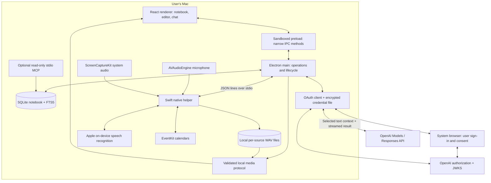
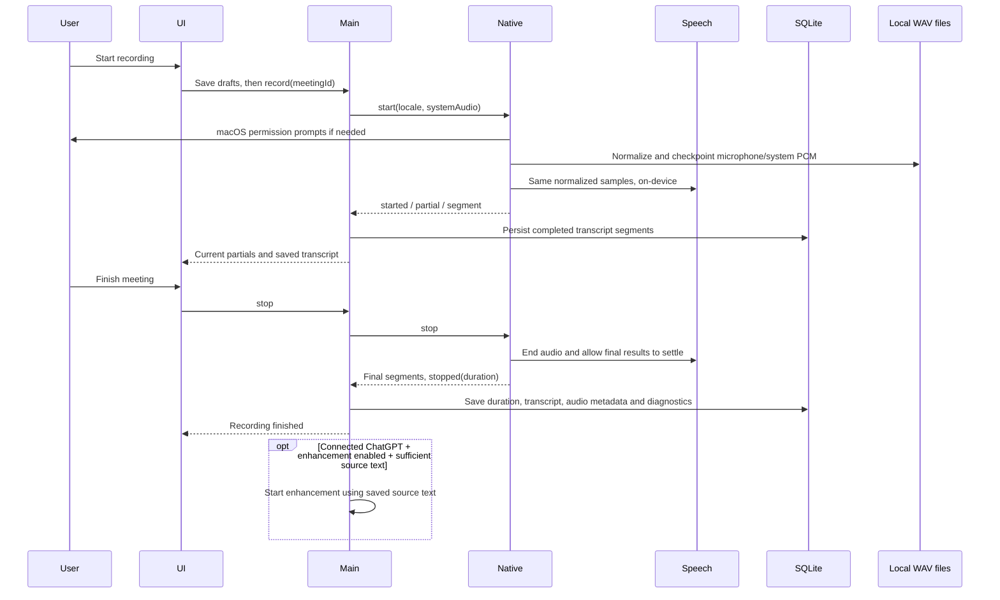

# Building Stillnote

Stillnote is a desktop meeting notebook with local capture and storage, plus text inference paid for through the user's eligible ChatGPT plan. The implementation deliberately separates the document, the recording session, and the AI response so that a failure in one does not erase the others.

## 1. Start with the constraints

The requested product is a Granola-like local application with the core meeting workflow, rather than Granola's complete cloud and team platform.

Two constraints determine the architecture:

1. **ChatGPT subscription access is an OAuth integration, not an API-key substitution.** OpenAI documents a public-client authorization flow, model discovery, streaming Responses requests, and limits. The app implements that protocol independently and uses the public `api.openai.com/v1` endpoint.
2. **That subscription route does not support transcription.** The Mac must turn audio into text before sending text to ChatGPT. Apple Speech can require on-device recognition, and ScreenCaptureKit can capture meeting-app audio without joining the meeting as a bot.

The architecture therefore uses Electron/React for the application, a small Swift process for macOS frameworks, SQLite for durable local data, and a main-process OAuth client for AI.

Official integration references, checked October 20, 2026:

- [Registration and sign-in](https://developers.openai.com/siwc/token-sharing-open-source/sign-in)
- [Models and inference](https://developers.openai.com/siwc/token-sharing-open-source/models-and-inference)
- [Accounts and sessions](https://developers.openai.com/siwc/token-sharing-open-source/profiles-and-sessions)
- [Preview limitations](https://developers.openai.com/siwc/token-sharing-open-source/preview-limitations)

No OpenAI DevKit source is vendored. OpenAI determines eligibility and service behavior; the app does not bypass those checks.

## 2. System architecture

The renderer does not have Node.js access, raw filesystem access, credentials, or a generic command-execution bridge. It loads bundled assets with a restrictive Content Security Policy. The main process validates the calling renderer and dispatches only named operations. The native helper accepts a small command vocabulary and never invokes the LLM.

## 3. Core components

| Component | Source | Responsibility |
| --- | --- | --- |
| Desktop coordinator | `app/main.mjs` | Creates the window, validates IPC senders, coordinates capture/AI, routes events, handles import/export dialogs, and flushes drafts before close. |
| Preload bridge | `app/preload.cjs` | Exposes the fixed `stillnote.call()` allowlist and event subscription; never exposes Electron or tokens directly. |
| Application UI | `app/ui.jsx` | Screen state, draft autosave, editor tabs, capture controls, chat scope/history, settings, and reversible actions. |
| Home feed | `app/components/HomeFeed.jsx` | Upcoming events, chronological meeting rows, search results, and honest empty states. |
| Content components | `app/components/Content.jsx` | Accessible icon buttons and safe Markdown with clickable meeting citations. |
| Local store | `app/store.mjs` | SQLite transactions, FTS indexing, meeting revisions, folders, message history, backup validation/restore, and bounded AI context construction. |
| Subscription authentication | `app/auth.mjs` | PKCE/OIDC sign-in, profile separation, model discovery, protected token storage, refresh, revocation, and public Responses requests. |
| Streaming parser | `app/stream.mjs` | Decodes fragmented SSE events and accepts a result only after `response.completed`. |
| Native capture | `native/Capture.swift` | Microphone/system audio, normalized PCM WAV persistence, graceful recognition windows, saved-file transcription, diagnostics, and EventKit reads. |
| Recording media | `app/recordings.mjs` | Validates recording paths, inspects/repairs canonical WAV headers, streams byte ranges, and assesses sparse transcript coverage. |
| Recording UI | `app/components/RecordingAudio.jsx` | Per-source playback, retry, language/source state, and coverage notices. |
| E2E harness | `scripts/e2e.mjs`, `tests/e2e/` | Isolated real Electron flows with deterministic native/provider adapters and persistent reports. |
| Local MCP | `scripts/mcp.mjs` | Optional read-only notebook access for local MCP clients. No network listener or write tools. |
| Build pipeline | `scripts/build.mjs` | Compiles the Swift executable, bundles main/preload with esbuild, and bundles React with Vite. |
| Packaging | `package.json` | Builds the macOS `.app`, bundles the native executable, and declares macOS permission descriptions. |

## 4. The capture path

### Native details

- `AVAudioEngine` captures the microphone. Capture, audio-track, and recognition-window state are isolated to the Swift main actor; audio callbacks transfer independently copied buffers.
- `SCStream` captures system audio using a display filter and audio output callback; no screen-frame output is registered or persisted.
- Two speech channels label the streams **You** and **Meeting audio**. These labels identify the input source, not individual remote participants.
- Each `SFSpeechAudioBufferRecognitionRequest` sets `requiresOnDeviceRecognition = true`.
- Recognition windows rotate after 40 seconds of audio. A draining window retains its task and callbacks for finalization instead of being cancelled immediately. Stable segment IDs keep overlapping final/partial events separate.
- Stopping finalizes the WAV files and waits for recognition completion, with a bounded 15-second fallback that retains the last partial. The stored duration excludes this drain time.
- Starting another recording on the same note adds a duration offset to transcript timestamps.
- `AVAudioConverter` normalizes hardware formats to 16 kHz mono float PCM. The same samples feed recognition and a canonical 16-bit WAV writer. Headers are checkpointed every second; audio is retained locally for replay and retry.

The helper emits newline-delimited JSON: lifecycle events, source levels, partial/final segments, warnings, calendar results, and file-transcription progress/completion. A helper failure preserves committed segments and the last available partial. On restart, unfinished sessions are marked interrupted; saved canonical WAV headers are repaired against actual bytes where necessary. An app/OS crash can still lose an in-memory partial, but retained audio provides a retry source.

System-audio permission failure falls back visibly to microphone-only capture. Unsupported on-device recognition or denied Speech permission produces a setup message while audio continues to be saved; it never silently invokes a cloud recognizer. Echo cancellation, overlapping speech, device changes, recognizer accuracy, and long-session stability need real meeting acceptance testing.

### Playback and retry

Each recording session has an ID, start time, duration offset, recognition locale, source status, track metadata, and diagnostics. `stillnote-audio://recording/...` resolves only registered local tracks, validates real paths, and supports streaming/byte ranges for native audio controls. No HTTP listener or arbitrary file URL is exposed.

Retry passes validated track paths to the helper. It transcribes saved audio in 30-second chunks using on-device file recognition. Only a successful, nonempty completed result replaces that session’s segments; manual text, other sessions, rough notes, and prior transcript versions are retained. Empty/error results preserve the old transcript. Sparse coverage skips automatic enhancement when there are no substantial rough notes, and directs the user to listen/retry.

## 5. The ChatGPT subscription path

### Sign-in

1. Generate and persist a per-installation `urn:uuid:…` host identifier.
2. Start an HTTP callback server bound to `127.0.0.1` on an available port.
3. Generate fresh OAuth state, OIDC nonce, and PKCE verifier/challenge.
4. Open the system browser at OpenAI's documented authorization endpoint. New registration uses `dynamic_agent_client`; a returning registration uses its saved issued client ID.
5. Validate the callback state and issued client ID. Save the registration before exchanging the code so a failed exchange can retry with the same client.
6. Exchange the code with the PKCE verifier and exact callback URL.
7. Verify the ID token signature, issuer, audience, expiration, nonce, and returning subject using `jose` and OpenAI's JWKS.
8. Enable inference only when the returned grant includes `chatgpt.tokens.use.direct`.

The callback server closes after success, cancellation, or timeout. It is not the notebook's API server.

### Credentials and refresh

Profiles retain their own client ID, verified identity, scopes, and token set. Email is a display label, not a unique registration key. The renderer receives only safe account metadata.

`safeStorage` encrypts credentials using the macOS-backed mechanism. Writes go to a temporary owner-only file and are atomically renamed. A single app instance owns the data directory. Concurrent refresh calls share one promise. A newly rotated token set is encrypted and checkpointed before identity verification finishes, so a transient verification outage does not discard the only replacement refresh token.

Sign-out attempts remote refresh-token revocation, clears local tokens, and reports when remote revocation was not confirmed. Model choices are refreshed for the selected account. There is no API-key field or hidden API-key fallback.

### Inference

- Discover account models from `GET /v1/models`.
- Send `POST /v1/responses` with the OAuth bearer token, `store: false`, and `stream: true`.
- Supply a bounded text context, task instructions, and relevant recent messages.
- Stream provisional text to the UI.
- Commit a summary or assistant message only after `response.completed` and nonempty text.
- Handle failed, incomplete, aborted, empty, or disconnected streams as failures, preserving the previous summary.

The app does not provide the model with filesystem, shell, email, calendar-write, or other execution tools. Meeting content is explicitly treated as untrusted source material. Follow-up emails are drafts inside chat.

## 6. Notes, evidence, and chat

A meeting stores separate `notes`, `summary`, `transcript`, and `versions` fields. Enhancing never overwrites the user's rough notes. Updating an existing summary keeps up to 20 prior versions. Transcript segments can be corrected, renamed, or deleted; their search index is updated transactionally.

For enhancement, the app supplies the selected meeting, its rough notes, full transcript, and chosen template. For chat, it supplies the chosen meeting/folder/notebook and up to 12 recent messages from that scope. Prompts request decisions, commitments, and owners only when evidence supports them.

Context is bounded at 350,000 source characters. Oversized selections fail with a request to choose fewer meetings; the app does not silently truncate a transcript and present the answer as complete. This first version uses explicit context, not an embeddings service or semantic retrieval backend.

Current source blocks receive `[1]`, `[2]`, etc., with stable meeting IDs. Returned citation numbers are resolved against that request's sources. Historical answer citations are expanded to their original meeting identities before reuse, avoiding accidental remapping when the notebook changes. Clicking a source opens its transcript. These are **meeting-level citations**, not validated sentence-level evidence alignments.

## 7. Persistence model

| SQLite object | Contents |
| --- | --- |
| `meetings` | One JSON meeting document per UUID: title, timestamps, participants, rough notes, summary, transcript segments, duration, template, folder, star, Trash state, summary versions, recording metadata, and prior recording transcript versions. |
| `folders` | Folder UUID and name. |
| `messages` | Chat message UUID, scope, role, content, timestamp, and source references. |
| `settings` | Local preferences, selected model, language, capture mode, custom templates/recipes, automatic enhancement. |
| `meeting_search` | FTS5 title/content index; excludes notes in Trash. CJK substring matching supplements Unicode token search. |

WAL mode permits the read-only MCP process to read while the desktop app writes. Search-index changes and meeting writes share a transaction. Trash is recoverable; this version does not implement permanent deletion or retention policies.

A JSON backup contains notebook data and settings, never credentials or raw audio. `audioIncluded: false` makes this explicit. Imported recording metadata cannot grant access to existing local audio files; copy the data directory separately to preserve recordings. Restore validates the complete input before starting mutations, merges new meeting IDs, and preserves existing meetings and existing preference values. Markdown export includes the user's notes, enhanced notes, and timestamped transcript.

The database is local but not application-encrypted. Disk protection relies on the macOS user account and, if enabled, FileVault. The credential file has a separate encryption boundary.

## 8. UI implementation and build sequence

The initial shell was refined using Granola's official Home, note-editor, enhanced-note, and Chat documentation. The resulting design uses a narrow sidebar, an upcoming-events card, chronological rows, serif document titles, a quiet writing canvas, and a persistent bottom dock. Product identity and assets are independently created.

The implementation order was:

1. Verify subscription authentication and transcription constraints against the current official documentation.
2. Implement durable local storage and its search, backup, and revision behavior.
3. Implement OAuth, OIDC verification, refresh, and completion-aware streaming separately from the renderer.
4. Build and compile the native capture/calendar helper.
5. Connect the renderer through explicit IPC operations and JSON-line native events.
6. Refine the home/editor/chat hierarchy against Granola's screenshots.
7. Test core invariants and exercise the real Electron app with isolated fictional data.
8. Package the native helper and permission descriptions into a macOS app and publish source and documentation.

`npm run build` produces three outputs: the native helper, bundled Electron main/preload, and renderer assets. `npm run package` places them into a standalone `.app`. No local server, cloud database, or service deployment is required.

## 9. Validation and deliberate limits

See [VALIDATION.md](VALIDATION.md) for executed checks and outstanding acceptance tests. Synthetic OAuth tests are not proof that an arbitrary ChatGPT account is eligible. Compiling the Swift helper is not proof that a real microphone/system-audio session has succeeded.

The native and deterministic E2E testing layers are described in [TESTING.md](TESTING.md); they have separate acceptance boundaries.

The core release deliberately omits shared spaces, cloud sync, CRM integrations, published share links, mobile clients, automatic meeting detection, and automatic remote-speaker diarization. The macOS UI currently targets desktop window sizes of 1,000 pixels and above. Network or account failures preserve the notebook, but this version has no offline LLM and no background retry queue for AI jobs.
