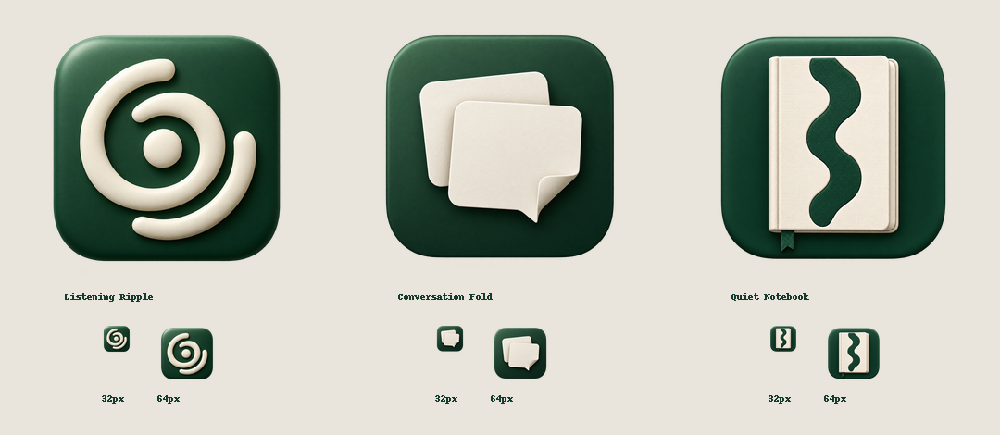

# Stillnote icon alternatives

Three additional directions, generated with the built-in image generation tool on 2026-10-20. The active application icon is unchanged. Originals remain in the tool's generated-images directory; copies of all requested final options are stored here.



| Option | Intent | Tradeoff |
| --- | --- | --- |
| [Listening Ripple](../assets/icon-options/listening-ripple.png) | Quiet listening, sound settling into memory; bold circular porcelain mark. | Clearest abstract silhouette at small size; can suggest a broadcast or audio utility more than notes. |
| [Conversation Fold](../assets/icon-options/conversation-fold.png) | Conversation becomes a tactile paper note; overlapping ivory cards. | Best balance of meeting and note meaning. Broad shapes survive reduction; the folded corner becomes subtle at 32px. Recommended. |
| [Quiet Notebook](../assets/icon-options/quiet-notebook.png) | A personal notebook with a broad voice-wave inlay. | Most literal note-taking signal and warmest material. More cover detail and visual weight than the other options. |

## Verification

All three final PNGs were inspected at full size and in a comparison showing 32px and 64px versions. All have RGBA channels, transparent outside corners, green rounded-square tiles, and distinct central silhouettes. No text was requested or generated. Texture and shading naturally simplify at small sizes. These are review options; no replacement of the installed icon or packaging assets was performed.

The notebook direction was refined to keep a clean transparent silhouette. Only the three final options and their comparison are published.

## Exact prompts

### Listening Ripple

```text
Use case: logo-brand
Asset type: polished macOS app icon for Stillnote, a calm meeting recorder and personal notes app.
Primary request: an original "Listening Ripple" icon. A sculptural ivory spiral ripple, built from two broad open concentric arcs and a small solid center, suggesting quiet attentive listening and sound settling into memory. The shape must be bold, centered and recognizable as a single mark at 32 pixels.
Scene/backdrop: one forest-green rounded-square macOS icon tile, inset about 10% from all canvas edges. True transparent alpha outside the tile, including the corners. Front facing square composition.
Style/medium: premium restrained 3D product icon; smooth matte porcelain ivory arcs raised above a deep forest green softly beveled tile. Subtle top-left light and occlusion; substantial simple forms and generous spacing.
Color palette: deep forest green and warm ivory only, tiny natural shading variations.
Constraints: one icon only, no collage, no text, no letters, no microphone, no headphones, no thin lines, no extra symbols, no watermark, no shadow extending beyond the transparent canvas. Avoid literal paper folded into an S; this must have its own circular silhouette.
```

### Conversation Fold

```text
Use case: logo-brand
Asset type: polished macOS app icon for Stillnote, a calm meeting recorder and personal notes app.
Primary request: an original "Conversation Fold" icon. Two broad ivory paper conversation cards overlap, forming one compact sculptural conversational emblem. The front card has a single generous folded lower corner that also reads as a short speech tail; the rear card peeks out at upper left. No marks or text on either card. Strong readable silhouette at 32 pixels.
Scene/backdrop: one forest-green rounded-square macOS icon tile, inset about 10% from all canvas edges. True transparent alpha outside the tile, including the corners. Front facing square composition.
Style/medium: elegant tactile paper sculpture, crisp but softly rounded ivory card edges, single broad fold, subtle top-left lighting and convincing soft contact shadows. Deep matte forest-green tile with restrained bevel.
Color palette: warm ivory paper against deep forest green, no accent colors.
Constraints: one icon only, no collage, no text, no letters, no microphone, no headphones, no lines suggesting writing, no watermark, no external cast shadow. Avoid the existing folded S ribbon; the silhouette is two overlapping conversational notes.
```

### Quiet Notebook — selected final generation

```text
Use case: logo-brand
Asset type: macOS icon for Stillnote meeting recording and notes app.
Create one premium 3D app icon. Center an upright pocket notebook on a deep forest-green rounded-square tile. The notebook has a warm ivory cloth hardcover with subtly rounded edges and ivory visible page block. A broad deep green vertical wave inlay on the cover has three connected lobes, suggesting recorded voice. Small forest green bookmark projects under the book. Nearly orthographic front view, subtle depth, calm studio lighting. Large simple recognizable forms and strong contrast legible at 32 pixels. Tile occupies the middle 80 percent of a square canvas and has smooth continuous rounded corners. Outside tile is genuine transparent alpha. Dark green tile stays completely opaque. No white background or ivory tile. No detached shadows, ragged fringe, speckles or objects outside tile. One icon only, no text, letters, microphone, headphones, collage or watermark.
```

